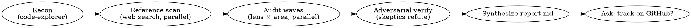

# Auditing AI-Developed Codebases

## Overview

AI-written code has characteristic failure modes: hallucinated APIs and dependencies, plausible-but-wrong logic, fabricated test assertions, stubs passing as done, over-engineered abstractions, redundant narration comments, and silent gaps versus how the real/official product behaves. This skill runs a **multi-agent, multi-wave audit** that hunts these systematically, **adversarially verifies** every finding, writes a severity-classified `report.md`, then offers to track the work as a GitHub umbrella issue with child issues.

**Core engine:** a Workflow script (`audit-workflow.js` in this skill dir) that fans out specialized agents across codebase areas and distinct bug-class waves. This skill tells you HOW to drive it.

**Hard requirement:** this skill is multi-agent and token-heavy by design — it calls the `Workflow` tool. Only run it when the user has opted into orchestration (they asked for an audit/review of the whole repo — that counts). Confirm scale with the user before launching if the repo is large.

## When to use

- Auditing a repo (or a large subsystem) that was mostly AI-generated.
- A deep, broad review across **correctness, security, AI-slop/hallucination, dead-code/over-engineering, useless comments, performance, structure/idiom best-practices, and feature-gaps vs reference implementations**.
- The user wants findings tracked as GitHub issues.

**Not for:** reviewing a single small diff (use `/code-review`), or a one-file change. Use this when breadth and multiple independent perspectives matter.

## The audit dimensions

Every finding is tagged with one dimension. The waves rotate through these so each wave hunts a **different bug class** (this is what makes multiple passes find different bugs, not the same ones again):

| Dimension | What the finder hunts |
|-----------|----------------------|
| `bugs` | Logic errors, edge cases, race conditions, nil/None derefs, broken error handling, off-by-one, resource leaks |
| `security` | Injection, hardcoded secrets, auth/authz gaps, unsafe deserialization, path traversal, SSRF, vulnerable deps |
| `slop` | Hallucinated APIs/deps/imports, invented functions, fabricated/no-op test assertions, stubs/TODOs masquerading as done, plausible-but-wrong logic, copy-paste drift |
| `bloat` | Dead code, unused abstractions, speculative generality, duplication, needless indirection, over-engineering |
| `comments` | Redundant comments restating code, AI-narration ("Now we loop over..."), stale/misleading comments, commented-out code |
| `perf` | Hot-path allocations, N+1 queries, O(n²) where O(n) exists, unbounded buffers, missing streaming/pooling, redundant recomputation |
| `structure` | Design-pattern & language best-practice enforcement — idioms, design patterns, and anti-patterns for the **detected language(s)**. Go: `internal/` vs `pkg/`, accept-interfaces/return-structs, error wrapping (`%w`), context propagation; Python: layout, type hints, context managers, no mutable defaults; TS/JS: module boundaries, async correctness. Flags SOLID violations, god objects, leaky abstractions, wrong-layer logic, missing canonical patterns. Driven by the detected stack + any loaded stack skill. |
| `gaps` | Missing features / wrong behavior vs the official or reference implementation of this product class (found via web search) |

## Workflow



1. **Detect repo + scale.** Confirm the target path (default: cwd). Ask the user roughly how thorough — quick / standard / deep — only if unclear; default standard.
   - **Load stack/language skills.** After recon names the stack, load any installed skills relevant to it and feed their guidance into the audit (pass via `args.stackGuidance`). Examples: `claude-api` for Anthropic-SDK code, `frontend-design` for web UI, a Go/Python/Rust idiom skill if present. These sharpen the `structure` and language-specific finders — the audit judges the code against that skill's best practices, not generic ones.
2. **Run the Workflow.** Call the `Workflow` tool with `scriptPath` pointing at this skill's `audit-workflow.js`, passing `args: { repoPath, depth }`. The script:
   - **Recon** — sizes the repo, then a `feature-dev:code-explorer` agent maps stack, frameworks, product type, per-stack idiom rules, and partitions the codebase into independent **focused areas** (small enough — ~3k LOC — for one agent to audit deeply), each tagged by importance (critical/high/normal; critical = entrypoints/data-plane/auth/persistence). **Multi-module & deployment coverage:** recon enumerates **every** build root (each `go.mod`/`package.json`/`Cargo.toml`/etc. = its own area — not just the primary module) plus deployment surfaces (Dockerfiles, docker-compose, `k8s/` operators, Helm charts, `deploy/`). When `stackGuidance` flags specific subsystems/dirs as critical, those must each appear as their own `critical`-tagged area. **Pinned areas:** when the area count exceeds the fan-out cap, deployment/operator areas (matched by path) **and** any `critical`-tagged area are **pinned** — kept even over the cap; only lower-importance *non-pinned* overflow is dropped (both pinned and dropped sets are logged). This fixed a real run where the K8s operator (its own `go.mod`) + Dockerfiles got **zero** coverage. **Large repos:** recon first writes `AUDIT-MAP.md` — a Mermaid subsystem/dependency diagram + area table — so each section is tackled in focus and in priority order.
   - **Reference scan** — parallel web-search agents find the official / canonical / popular implementations of this product class and produce an expected-behavior + feature checklist (feeds the `gaps` dimension).
   - **Audit waves** — for each **dimension lens**, fan out one finder **per area in parallel**. Distinct lens per wave ⇒ distinct bug classes. `structure` uses `feature-dev:code-architect`; the rest use `feature-dev:code-reviewer`-style finders.
   - **Deep waves (ON BY DEFAULT)** — a completeness critic asks "what did earlier waves miss?" and re-hunts cross-file/integration bugs the scoped finders structurally can't reach; dedup against everything already seen so waves never re-report the same bug. Runs a baseline of rounds even with no token budget; a `+Nk` budget extends it. Disable with `deepRounds: 0`.
   - **Adversarial verify** — every fresh finding gets independent skeptics prompted to **refute** it; a finding is `confirmed` only if it passes ALL THREE: (1) **confirmed from source** (not a misread), (2) **reachable in production** — the affected symbol is constructed/called from a non-test entrypoint (grep for callers; dead/test-only code → refuted as `bloat`, not a live bug), and (3) **not spec-correct behavior** — for protocol/security/interop claims the current behavior is actually wrong vs the spec/reference AND a fix wouldn't break conformance. Kills hallucinated, dead-code, and spec-misreading findings.
   - **Synthesize (incremental / streaming)** — the report is written in pieces, never as one giant `Write`: a report-init agent writes the header + by-dimension + by-area summary tables, then one agent **per ~15-finding chunk** *appends* its section, run strictly serially via a pipeline (concurrent appends to one file corrupt it), then a tail agent appends the gaps-vs-reference section. This keeps progress visible and avoids the failure mode where one agent streamed a 200+ finding `report.md` token-by-token into a single tool call — 17+ min with no file on disk, indistinguishable from a hang and a no-output-watchdog risk. The same incremental writer backs `report.md`, `report-verified.md` (verifySeed) and `report-deepwaves.md` (deepOnly); the report format is unchanged.
3. **Present the summary** the workflow returns (counts by severity/dimension/area, path to `report.md`).
4. **Offer GitHub tracking.** Use `AskUserQuestion`: "Track these findings on GitHub?" If yes:
   - Create one **umbrella issue** (title like `Audit: <repo> — N findings across M areas`) with a checklist linking child issues.
   - Create one **child issue per improvement area** (or per HIGH finding cluster — ask which granularity), each labeled by dimension, referencing `report.md`, with `file:line` + remediation.
   - Edit the umbrella body to link all children. Print every issue URL and verify it printed (zsh won't word-split unquoted vars — pass `gh` flags inline, don't build a flag string in a var).

## Driving the workflow

```
Workflow({ scriptPath: "~/.claude/skills/auditing-ai-codebases/audit-workflow.js",
           args: { repoPath: "/abs/path/to/repo", depth: "standard", passes: 6 } })
```

**`args`:**
- `repoPath` — target repo (default cwd).
- `depth` — `quick` | `standard` | `deep`. Sets skeptics/default pass count.
- `passes` — **how many distinct bug-class waves** (one lens per wave). Default from depth (`quick`=3, `standard`=6, `deep`=8). Capped at 8 lenses.
- `deepRounds` — DeepWaves baseline rounds, run **even with no token budget** (default 2, max 6, `0` disables). Cross-file/integration completeness critic. A `+Nk` budget extends beyond the baseline.
- `lenses` — explicit array of lens keys (e.g. `["perf","structure","bloat","comments","gaps"]`) to run EXACTLY those, in any position, instead of the first `passes`. Lets you run only the dimensions a prior pass skipped.
- `deepOnly` + `seed`/`seedPath` — run **only** DeepWaves against an existing audit: pass `seed` (array of prior findings `{file,line,title,area,dimension,severity}`) or `seedPath` (path to a prior findings JSON) to dedup against; recon/reference/finders are skipped. Writes `report-deepwaves.md` (delta).
- `verifySeed` + `seed`/`seedPath` (+ optional `verifySeverities:["HIGH","MED"]`) — run **only the adversarial verify gate** on a seed of UNVERIFIED findings against a clean `repoPath`, re-grade severity, write `report-verified.md`. This is the **interrupted-run recovery** path (see Recovery below): reuse a killed run's raw finder output instead of re-finding. No recon/finders/deepwaves.
- **Seed loading is chunked.** Both `deepOnly` and `verifySeed` load `seedPath` via a count-probe + parallel shell-slice loaders (≤150 findings each). Loading a 1000+ finding seed through one agent makes it echo every item token-by-token, which trips the stream watchdog and stalls the run — chunking avoids that. Passing `seed` inline (already-parsed) skips loading entirely.
- `maxFinderAgents` (default 120) — bounds finder fan-out. Areas are capped to `floor(maxFinderAgents/passes)`, lowest-importance *non-pinned* overflow dropped (logged). **Pinned = deployment/operator areas (path match: Dockerfile*, docker-compose*, `/k8s/`, `/chart/`, `/helm/`, `/deploy/`, operator) or any `critical`-tagged area — kept even past the cap** so secondary modules and deployment surfaces never get silently culled. **This is the guardrail against the 1000-agent cap** — see Scaling below.
- `maxVerify` (default 300) — max findings sent to adversarial verify (top-N by severity).
- `models` — per-role model override, e.g. `{finder:"sonnet", verify:"opus", probe:"haiku"}`. See Cost below.
- `fresh` (default false) / `cacheDir` — resume controls. See Resume below.

### Scaling & the agent cap (READ THIS)
The Workflow agent cap is **1000, hard**. Cost = `areas×passes` finders + `~findings/10` verify batches + overhead. Verify is **batched** (one agent per ~10 findings) precisely so a big repo can't blow the cap. Finder fan-out is bounded by `maxFinderAgents`. For a huge repo, prefer scoping `repoPath` to a subsystem and running several focused audits over cranking `maxFinderAgents` — deep per-area beats shallow whole-repo.

### Cost / models / effort
High-volume, lower-judgement agents run on cheap tiers by default: **Haiku** size-probe, **Sonnet** finders/verify/recon/reference/report. Bump quality where it matters via `models` (e.g. `{verify:"opus"}`). Note: the Workflow `agent()` API exposes **model tier but not a reasoning-effort knob** — tier selection is the lever. The first DittoFS run on all-Opus cost 35M tokens; Sonnet finders cut that hard.

### Resume (cross-session)
Two layers:
- **Same session:** re-invoke with `resumeFromRunId` — cached `agent()` calls (recon/reference/finished finders) return instantly.
- **Across sessions / after a crash:** durable disk cache under `cacheDir` (default `<repo>/.audit-cache`). Each finder cell writes `findings/<lens>__<area>.json`; verify writes `verdicts.json`. **Just re-run the same `Workflow` call** — it reads the cache and only does missing finder cells + unverified findings. Pass `fresh:true` to ignore the cache and start clean. This is what lets a 2-hour audit survive interruption and continue in a new session.

Iterate on the script itself by editing `audit-workflow.js` and re-invoking with the same `scriptPath`. DeepWaves runs a baseline `deepRounds` (default 2) regardless of budget; a `+Nk` token budget extends it up to the max.

### Audit an immutable tree (HARD RULE)
**Always audit a detached worktree of the canonical ref, never the live working tree.** Branch switches, in-flight edits, or another agent touching files mid-run make the audit read an inconsistent tree — findings reference code that no longer matches, and you can't trust them. Before launching:
```
git worktree add --detach /tmp/audit-develop origin/develop
git -C /tmp/audit-develop merge-base --is-ancestor HEAD origin/develop   # verify it IS the ref
Workflow({ scriptPath: ".../audit-workflow.js", args: { repoPath: "/tmp/audit-develop", ... } })
```
Keep that worktree untouched for the run's duration. (This is the repeated "stale-tree" lesson — auditing the live tree has burned multiple runs.)

### Recovery from an interrupted run (don't re-find)
If a run is killed/stalls after its finders ran but before verify/report, the finder output is **not lost** — salvage and reuse it:
1. **Salvage** raw findings from the run's journal — `…/subagents/workflows/<wf_id>/journal.jsonl`, every `{"type":"result"}` line carries a `result.findings[]`. Dedup by `(file,line,title)` → a seed JSON.
2. **Re-verify, don't re-find.** Run `verifySeed` mode with `seedPath` pointing at that JSON, against a **clean immutable worktree** (above). The adversarial gate filters already-fixed / dead-code / spec-correct / negligible and re-grades severity — turning raw finder noise into a trustworthy list. (On the DittoFS run this was 1035 raw → 44 confirmed; re-finding would have wasted ~100 agents.)
3. To also extend coverage, follow with `deepOnly` seeded by the same JSON for the cross-file delta.
Do NOT try to `resumeFromRunId` across a changed `repoPath` — it starts fresh. Resume only reuses cache for the identical run.

## Report.md format

```markdown
# Audit Report — <repo>  (<date>, <commit>)
Stack: <languages/frameworks>   Areas: <N>   Findings: <H> HIGH / <M> MED / <L> LOW

## Summary by dimension
| Dimension | HIGH | MED | LOW |
...

## Findings
### [HIGH] <title>  · `dimension` · area: <area>
- **Where:** `path/to/file.go:123`
- **What:** <the problem, concretely>
- **Why it matters:** <impact>
- **Fix:** <specific remediation>
- **Verified:** survived N/M refutation attempts

## Implementation gaps vs reference
<table: expected behavior → our behavior → gap → source URL>
```

## Common mistakes

- **Skipping adversarial verify** → report full of plausible-but-wrong findings (the exact failure mode you're auditing for). Never report unverified findings as confirmed.
- **Same bugs every wave** → caused by not rotating the lens and not deduping against `seen`. Each wave must hunt a distinct dimension and dedup by `file:line:title`.
- **One giant finder over the whole repo** → context overflow, shallow results. Partition into areas; parallelize.
- **Auto-filing GH issues without asking** → always `AskUserQuestion` first; issue creation is outward-facing and hard to undo.
- **Hand-waving the `gaps` dimension** → it must be grounded in a real reference implementation found via web search, with a source URL, not from memory.
- **Trusting AI tests as proof** → fabricated/no-op assertions are a `slop` finding, not evidence the code works.
- **Reporting a bug in dead/unreachable code** → area-scoped finders read files in isolation and can't see the call graph, so they flag real *patterns* in code that's never constructed/called in production. The verify gate must confirm **reachability** (a non-test caller exists) before confirming a HIGH; dead code is a `bloat` finding, not a live bug. (Real miss: a fix shipped against an unused `SMBAuthenticator` while the live path was already correct.)
- **Flagging spec-correct behavior as a vuln** → "unauthenticated X" / "missing check" findings are often protocol-compliant (e.g. anonymous SMB2 IPC$ connect). The verify gate must check the behavior against the spec/reference and whether a fix would break conformance — else the fix regresses interop tests. (Real miss: an IPC$ anon-rejection "fix" broke `smb2.anon-signing`/`anon-encryption`.)

## Note on this skill's own testing

This is a technique/orchestration skill. Validate it the TDD way before relying on it: run it against one real AI-built repo, confirm (a) findings are real (spot-check 3 HIGHs against source), (b) waves surface *different* bugs, (c) the report and GH issues are well-formed. Refine `audit-workflow.js` against what that run misses.
