# Fixing Audit Findings

## Overview

Companion to `auditing-ai-codebases`. Takes the audit's `report.md` (and the GitHub umbrella/child issues, if they exist) and **plans, then executes the remediation in parallel waves** of agents, each working an isolated git worktree to avoid collisions, then opens a single PR that references the tracking issues. A code-review gate runs before the PR.

**Core engine:** a Workflow script (`fix-workflow.js` in this skill dir) — plan wave → parallel fix waves → verify → assemble branch. This skill drives it.

**Hard requirement:** multi-agent and token-heavy — calls the `Workflow` tool. Run only when the user asked to implement audit fixes (that opt-in counts). Confirm scope before launching.

## When to use

- A `report.md` (or audit JSON / list of GitHub issues) exists and the user wants it remediated.
- The fixes are independent enough to parallelize across the codebase.

**Not for:** a single targeted bug (just fix it inline), or findings that need product decisions (surface those to the user first).

## Inputs

- `reportPath` — path to `report.md` (default: `./report.md`).
- `repoPath` — repo root (default cwd).
- `umbrellaIssue` / `issueMap` — optional. If the audit filed GH issues, pass the umbrella number and a finding→issue mapping so commits/PR can reference them (`Fixes #N`).
- `severities` — which to fix this run: default `HIGH,MED`. LOW opt-in.
- `maxParallel` — fix agents per wave (default 6).
- `mergeStrategy` — `squash` | `rebase` | `merge` (default `squash`). Used at the **merge** step after CI is green.
- `models` — per-role override, e.g. `{plan:"sonnet", review:"opus"}`. Defaults: parse/plan/review/re-audit/history/assemble on **Sonnet** (low-judgement / mechanical); **fix and simplify+tests stay on the default/main model (Opus)** since code-writing is the demanding part. (The Workflow `agent()` API exposes model tier, not a reasoning-effort knob — tier is the lever.)
- `branchTag` — names the integration branch `audit-fixes-<branchTag>`.

### Resume (cross-session)
- **Same session:** re-invoke with `resumeFromRunId` — completed `agent()` calls return cached.
- **Across sessions:** resume is **git-native** — landed fixes are real commits on worktree branches and the integration branch, which persist. Re-running is safe: already-fixed batches whose commits exist are detected and skipped, and assembly continues onto the existing integration branch. The PR-watch/merge loop (step 4–5) is driven from the main loop, so a new session can pick it up by pointing at the open PR number. Pass `fresh:true` to start a clean branch.

## Workflow

```dot
digraph fix {
  rankdir=LR;
  "Parse + classify" -> "Plan (code-architect)";
  "Plan (code-architect)" -> "Fix waves (parallel worktrees)";
  "Fix waves (parallel worktrees)" -> "Verify (build+test+review)";
  "Verify (build+test+review)" -> "Assemble branch";
  "Assemble branch" -> "Harden (simplify+tests+re-audit+linear history)";
  "Harden (simplify+tests+re-audit+linear history)" -> "Open PR";
  "Open PR" -> "Watch CI + Copilot, iterate";
  "Watch CI + Copilot, iterate" -> "Merge (strategy) + close issues";
}
```



1. **Confirm scope.** Read `report.md`. Show the user the counts (by severity/dimension/area) and which severities will be fixed. Get the green light.
2. **Run the Workflow** (`scriptPath` → this skill's `fix-workflow.js`, with the args above). The script:
   - **Parse + classify** — extract findings; group into **independent fix batches** (by file/area so two agents never touch the same file). Drop anything needing a product decision into a `deferred` list.
   - **Plan** — a `feature-dev:code-architect` agent turns each batch into a concrete fix plan (files, approach, risk, test to add/run).
   - **Fix waves** — `pipeline`/`parallel` over batches; each fix agent works in `isolation: 'worktree'` so parallel edits don't collide. It implements the fix **and** adds a test proving it (fails-before/passes-after), commits atomically referencing the finding and `Fixes #<issue>`. Severity-ordered: HIGH first, then MED, etc.
   - **Verify** — build + test per batch; a `feature-dev:code-reviewer` gate reviews each diff. Failed/regressing batches are excluded and reported, not merged.
   - **Assemble** — merge passing worktree branches into one integration branch off the default branch.
   - **Harden** (parallel where safe) — on the integration branch: a **simplify** pass + **add useful tests** (sequential editing), plus in parallel a **re-audit vs the original plan** (confirms each finding genuinely fixed, no regressions) and a **final whole-diff code review**; then **linearize history** (rebase onto default, squash WIP into coherent atomic commits). Returns `readyForPR` only if re-audit passed, final review approved, and tests green.
   The workflow returns the integration branch + `readyForPR` + `prRefs` + `mergeStrategy`; it does **not** push or open the PR.
3. **Open the PR** (main loop). If `readyForPR`, push the branch and `gh pr create` with a body listing fixed findings by severity, linking `report.md`, with `Part of #<umbrella>` and `Fixes #<n>` per child issue (auto-closes on merge). Assign per the project's PR conventions. Print + verify the PR URL. If not `readyForPR`, surface the blockers instead.
4. **Watch + iterate until green** (main loop, can run via the `loop` skill). Poll `gh pr checks <pr> --watch` and `gh pr view <pr> --comments` (Copilot/reviewer comments). For each failing check or unresolved comment, dispatch a fix agent (parallel when the failures are independent) — use **systematic-debugging** for non-obvious CI failures — commit, push, re-poll. Repeat until **all checks green and all comments resolved**.
5. **Merge + close** (main loop). With the user's go-ahead, `gh pr merge <pr> --<mergeStrategy>` (`squash`/`rebase`/`merge` from the param) `--delete-branch`. Confirm linked issues closed (the `Fixes #` trailers handle children; close/`gh issue comment` the umbrella with a summary).
6. **Report** what landed, what was **deferred**, what **failed verification**, and the merged PR + closed issues.

## Reuse existing skills (don't reinvent)

The driver should lean on installed skills rather than ad-hoc agents where one fits:

| Step | Reuse |
|------|-------|
| Simplify pass | `/simplify` (or `simplify` skill) on the integration diff |
| Pre-PR review | `/code-review` (high effort) and/or `superpowers:requesting-code-review` |
| Tests | `superpowers:test-driven-development` discipline for added tests |
| Debug CI failures | `superpowers:systematic-debugging` |
| Don't claim green falsely | `superpowers:verification-before-completion` before each "fixed" claim |
| Branch finish / PR mechanics | `superpowers:finishing-a-development-branch`; `gsd-ship` if the project uses GSD |
| Linear history | `feedback_always_rebase_never_merge` convention — rebase, never merge develop in |

The Harden phase in `fix-workflow.js` encodes the equivalent passes as agents so they parallelize; the main-loop driver may instead invoke the slash skills directly on the working tree when not parallelizing.

## Driving the workflow

```
Workflow({ scriptPath: "~/.claude/skills/fixing-audit-findings/fix-workflow.js",
           args: { repoPath: "/abs/repo", reportPath: "/abs/repo/report.md",
                   severities: "HIGH,MED", maxParallel: 6,
                   umbrellaIssue: 1234, issueMap: { "<finding title>": 1235 } } })
```

The workflow returns: integration branch name, per-batch results (landed/failed/deferred), test status. **You** open the PR from the main loop (PR creation is outward-facing — don't bury it in the workflow; do it explicitly and confirm with the user if not pre-authorized).

## Project conventions to honor

- Follow the repo's branch/PR rules (read its `CLAUDE.md`): branch from the **default branch**, never commit on protected branches, **sign commits** if the project requires it, keep messages concise, and **never reference AI tooling** in commits/PRs if the project forbids it.
- Prefer **rebase** over merge for feature branches if the project requires linear history.
- Run the project's real build/lint/test commands (from its `CLAUDE.md`/Makefile), not assumed ones.

## Common mistakes

- **Two agents editing one file in parallel** → always isolate fix agents in worktrees and batch by file/area.
- **Claiming fixed without a test** → each fix lands with a test that fails before and passes after; otherwise it's a `slop` fix repeating the original sin.
- **Opening a PR with failing build/tests** → verify gate must be green; failed batches are excluded and reported, not shipped.
- **Auto-merging or force-pushing without asking** → stop at PR open; let the user merge.
- **Losing issue links** → reference `Fixes #N` per child + `Part of #<umbrella>` so the tracker closes on merge.
- **Fixing findings that are actually product decisions** → defer and surface, don't guess.

## Note on this skill's own testing

Technique/orchestration skill — validate before relying: run it against a real `report.md`, confirm (a) fixes are correct and tested, (b) parallel worktrees don't collide, (c) the PR references issues and closes them on merge, (d) deferred items are sensibly chosen. Refine `fix-workflow.js` from what that run gets wrong.
