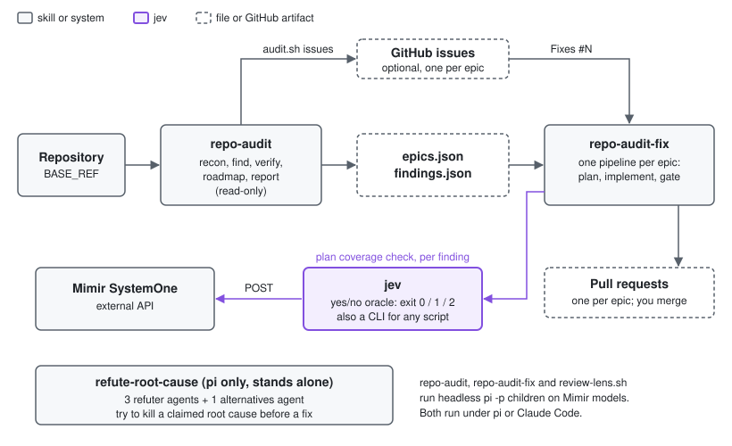

# Skills documentation



| Page | Content |
|---|---|
| This page | Install, prerequisites, quick start for each skill, troubleshooting |
| [jev.md](jev.md) | The jev algorithm, exit codes, and how the skills use jev |
| [repo-audit-fix.md](repo-audit-fix.md) | The per-epic pipeline and its convergence limits |
| [pr-review.md](pr-review.md) | The council review pipeline, convergence, config and resume |

The skills:

- `repo-audit` audits a repository and writes findings and epics.
- `repo-audit-fix` reads those epics, fixes each one, and opens one PR per epic.
- `jev` answers yes/no questions. `repo-audit-fix` uses it as a second check on plans.
- `pr-review` reviews one GitHub PR with a council of different models and posts only the findings they agree on. It uses `jev` to settle splits.
- `refute-root-cause` tries to disprove a claimed root cause. It stands alone.

## Install

1. Clone the repository.
2. Run `./install.sh` from the repository root.
3. To remove the links, run `./install.sh --rm`.

`install.sh` creates symlinks. It does not copy files.

| Source | Link target | Override |
|---|---|---|
| `pi/<skill>` | `~/.pi/agent/skills/<skill>` | `PI_DIR` |
| `claude/<skill>` | `~/.claude/skills/<skill>` | `CLAUDE_DIR` |
| `shared/<skill>` | both directories above | |
| `shared/<skill>/bin/*` | `~/.local/bin/` (for example `~/.local/bin/jev`) | `BIN_DIR` |

- You can run `install.sh` again after a pull. It is idempotent.
- If a real directory has the same name, `install.sh` moves it to `<name>.pre-skills-repo`.
- `--rm` removes only the symlinks that point into this repository.

## Prerequisites

| Tool | Used by |
|---|---|
| `pi` CLI | `repo-audit`, `repo-audit-fix`, `review-lens.sh` (headless `pi -p` children); `refute-root-cause` (pi `subagent` tool); `pr-review` seats with `harness: pi`, and `auto` seats when no router answers |
| `gh` (logged in) | `audit.sh issues`, `fix.sh plan` (issue map), `fix.sh` PR stage; `pr-review` and `pr-review-loop`: all GitHub reads and posts |
| `node` | JSON steps in `audit.sh` and `fix.sh`; the `pr-review` engine |
| `claude` CLI | `pr-review` seats with `harness: claude` (the default judge and first seat) |
| `gitleaks` (optional) | `pr-review` outbound secret scan; built-in patterns without it |
| `python3` | `jev` (also the optional `pr-review` decider) |
| Mimir credentials | `jev`: `~/.config/mimir/api-key` and `~/.config/mimir/base-url` (ends in `/v1`) |

The Mimir credentials come from sops. Run `rebuild` in the dotfiles to write them.
The `pi` providers `cubbit` and `cubbit-headroom` must be configured for the default models.

## Quick start

The examples use the pi skill path `~/.pi/agent/skills`.
The Claude Code path `~/.claude/skills` works the same way.

### repo-audit

1. Go to the repository you want to audit.
2. Run all steps:

   ```sh
   sh ~/.pi/agent/skills/repo-audit/scripts/audit.sh all
   ```

3. Read the report at `/tmp/audit-<repo>/.audit/report.md`.
4. Review `epics.json` in the same directory.
5. Optional: create one GitHub issue per epic with `audit.sh issues`.

The audit runs on a detached worktree of `BASE_REF`. It never changes your checkout.
After a crash, run the same command again. Read `.audit/RESUME.md` for the state.
Other steps: `init recon research find verify aggregate roadmap report issues status clean`.

| Variable | Default | Purpose |
|---|---|---|
| `REPO` | `.` | Repository to audit |
| `WORKTREE` | `/tmp/audit-<repo>` | Audit worktree; state goes in `$WORKTREE/.audit` |
| `BASE_REF` | `origin/main` | Ref to audit |
| `AUDIT_LENSES` | `simplify,structure,tests,docs,ui,sql,bugs,api-design,security,slop` | Lenses to run |
| `CONCURRENCY` | `4` | Parallel finder children |
| `FINDINGS_CAP` | `12` | Maximum findings per lens and area |
| `TIMEOUT` | `2400` | Seconds per child |
| `REPO_CTX` | read `AGENTS.md` | One-line project context for every child |
| `SCOUT_MODEL`, `FINDER_MODEL`, `PRO_MODEL` | `cubbit/mimir-slim`, `cubbit/mimir`, `cubbit/mimir-pro` | Model routes |
| `DRY_RUN` | `0` | `1` = `issues` prints, does not create |

### repo-audit-fix

1. Run `repo-audit` first. Review `epics.json`.
2. Go to the repository you want to fix.
3. Run the engine:

   ```sh
   S=~/.pi/agent/skills/repo-audit-fix/scripts
   AUDIT_STATE=/tmp/audit-<repo>/.audit SCRIPTS=$S LENS=$S/review-lens.sh \
     sh $S/fix.sh run
   ```

4. Check progress with `fix.sh status`, or read `$FIXROOT/.fix/RESUME.md`.
5. Review and merge the PRs. The engine never merges.

Set `SCRIPTS` when the skill is not at `.agents/skills/repo-audit-fix/scripts` in the repository.
Set `LENS` when the repository has no `scripts/review-lens.sh`. Without a gate script, the engine stops.
Other commands: `plan` (build `plan.json` only) and `clean` (remove worktrees and local `fix/audit-*` branches).
For a cheap test run, use `EPIC_FILTER=<epic> DRY_RUN=1`.

| Variable | Default | Purpose |
|---|---|---|
| `AUDIT_STATE` | (required) | Directory with `epics.json` and `findings.json` |
| `REPO_DIR` | git toplevel | Main checkout |
| `FIXROOT` | `/tmp/audit-fix-<repo>` | Worktrees and state (`.fix/`) |
| `BASE_REF` | `origin/main` | Branch base and gate diff range |
| `CONCURRENCY` | `3` | Epics in parallel inside a wave |
| `PLAN_ROUNDS` | `5` | Plan reviews per epic before FATAL |
| `GATE_ROUNDS` | `2` | Code revise rounds before the epic is parked |
| `EPIC_FILTER` | (all) | Comma list of epics to run |
| `DRY_RUN` | `0` | `1` = do not push or open PRs |
| `JEV` | `auto` | `auto` = use `jev` when it is on `PATH`; `off` = never |
| `JEV_CONFIDENCE` | `0` | Minimum jev confidence to act on an answer. `0` = no gate: the benchmark shows confidence does not predict correctness |
| `TIMEOUT` | `3600` | Seconds per child |
| `REPO_CTX` | read `AGENTS.md` | One-line project context for every child |

Model routes: `SLIM_MODEL`, `PLAN_MODEL`, `REVIEW_MODEL`, `IMPL_MODEL`, each with a `*_PROVIDER` and `*_THINKING`.
See [repo-audit-fix.md](repo-audit-fix.md) for the pipeline.

### refute-root-cause

This skill is for pi only. It runs a pi `subagent` workflow.

1. Copy `refute-root-cause.js` to a scratch location. The installed file is a symlink into this repository.
2. Edit the `CONFIG` block in the copy: `CLAIM`, `EVIDENCE`, `SYMPTOM`, `LENSES`.
3. Write `CLAIM` as one falsifiable sentence.
4. Call the `subagent` tool once:

   ```text
   subagent({ workflowScriptPath: "<copy>/refute-root-cause.js",
              cwd: "<repo>", async: false, timeoutMs: 1200000 })
   ```

5. Read the result:
   - `panelFailed: true`: all refuters failed. The claim is untested. Run again.
   - A `kills` entry has a concrete counterexample. The claim is dead.
   - A `doubts` entry has no counterexample. Investigate that point.
   - `survives: true` and no plausible `alternatives`: you can trust the cause.

### jev

```sh
jev ask "Every changed path is under docs/." -t "$(git diff --name-only main)"
jev doubt "Water boils at 100 degrees Celsius at sea level." --json
```

1. Write the question so that "yes" is the answer you act on.
2. Branch on the exit code: `0` = yes, `1` = no, `2` = no answer.
3. Never treat exit `2` as "no".
4. `--confidence MIN` gives exit `2` ("unsure") below that confidence. The benchmark shows confidence does not predict correctness, so use it only with your own data (see `bench/jev/RESULTS.md`).
5. Never send secrets. The text goes to an external API.

Tests: `python3 -m unittest discover shared/jev`. Set `JEV_LIVE=1` to add a test against the real endpoint.
See [jev.md](jev.md) for the full algorithm.

### pr-review

1. Copy `shared/pr-review/config.example.json` to `~/.config/pr-review/config.json` and set your seats.
2. Check the setup:

   ```sh
   P=~/.claude/skills/pr-review/scripts/pr-review
   sh $P doctor
   ```

3. Try a review that posts nothing:

   ```sh
   sh $P review 42 --repo owner/repo --dry-run
   ```

4. Post it: run the same command without `--dry-run`.
5. On exit `3`, answer the open questions with `sh $P answer`, then run the same command again.
   In Claude Code or pi, ask "review PR 42" and the skill does this for you.

See [pr-review.md](pr-review.md) for the pipeline, effort levels and config.

## Troubleshooting

### `pi -p` hangs

Headless `pi -p` reads stdin when stdin is not a terminal.
If the pipe stays open, `pi -p` waits forever.
This happens when an agent harness or a `while read` loop runs the script.

The engines (`audit.sh`, `fix.sh`, `review-lens.sh`) start every `pi -p` child with `< /dev/null`.
In your own scripts, write `pi -p ... < /dev/null`.

### jev exits 2

Exit `2` means "no answer". The reason is on stderr. Causes:

- `~/.config/mimir/api-key` or `base-url` is missing. Run `rebuild`.
- The API is down, timed out (30 s), returned an HTTP error, or sent a redirect.
- The response is malformed.
- The text is empty, or the command line is wrong.
- The confidence is below `--confidence MIN`. The verdict is `unsure` and stderr is empty.

`repo-audit-fix` treats exit `2` as "unsure" and keeps its normal behaviour.
After the first outage, it stops calling jev for the rest of the run.

### Turn jev off

Set `JEV=off` for `repo-audit-fix`:

```sh
JEV=off AUDIT_STATE=... sh $S/fix.sh run
```

Use `JEV=off` when plans or findings can contain secrets.
For example, a `security` finding can quote a hardcoded key.

### An epic is FATAL or parked

- FATAL: a stage failed and wrote no marker. The log line starts with `fix: FATAL:`. Run `fix.sh run` again to retry that stage.
- Parked: the gate failed after `GATE_ROUNDS` revise rounds. Read `.fix/<epic>/blocked.md`.
  Fix by hand, or raise `GATE_ROUNDS` and run again.

### `pr-review` exits 4

A stage failed after its retries. Nothing was posted. The error names the child.
Run the same command again: it continues from the last finished child.
Run `pr-review doctor` to probe each seat.

### A claude seat says "Not logged in"

`claude -p --bare` drops the normal login. The engine uses `--bare` only when
`CLAUDE_CODE_OAUTH_TOKEN` is set, and `--restricted` otherwise.
Run `claude setup-token` and export the token, or unset a stale one.

### The review says `Locked`

Another run holds the repo lock. Wait for it. A lock with a dead PID is taken over by the next run.
`pr-review status` shows the holder.
