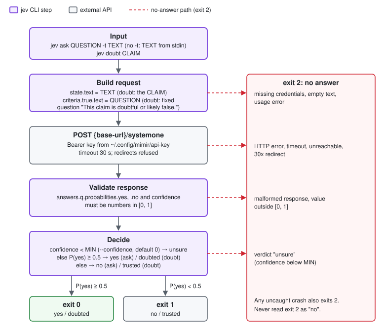

# jev

`jev` asks Mimir SystemOne one yes/no question about a text.
It returns a probability and a confidence, not prose.
The exit code is the decision. Source: `shared/jev/jev.py`.



## One call, step by step

1. Read the input.
   - `jev ask QUESTION -t TEXT`: the text comes from `-t`. Without `-t`, or with `-t -`, it comes from stdin.
   - `jev doubt CLAIM`: the text is the claim. The question is fixed: `This claim is doubtful or likely false.`
2. Stop with exit `2` if the text is empty or only whitespace.
3. Read the key from `~/.config/mimir/api-key` and the URL from `~/.config/mimir/base-url`. Stop with exit `2` if a file is missing.
4. Send `POST {base-url}/systemone` with a `Bearer` token and this body:

   ```json
   {"state": {"text": "<TEXT or CLAIM>"},
    "questions": {"q": {"type": "noul",
                        "criteria": {"true": {"text": "<QUESTION>"}, "false": null}}}}
   ```

5. Refuse redirects. A `30x` reply is an error. This keeps the key from following a redirect to another host.
6. Wait at most 30 seconds. An HTTP error, timeout, unreachable host, or non-JSON body gives exit `2`.
7. Validate the response. `answers.q.probabilities.yes`, `answers.q.probabilities.no` and `answers.q.confidence` must exist, be numbers, and be in `[0, 1]`. Otherwise exit `2`.
8. Apply the confidence gate. If `confidence < MIN` (`--confidence MIN`, default `0`), the verdict is `unsure` and the exit is `2`.
9. Apply the decision rule. If `P(yes) >= 0.5`, the verdict is `yes` (`ask`) or `doubted` (`doubt`), exit `0`. Otherwise it is `no` or `trusted`, exit `1`.
10. Print one line, or one JSON object with `--json`:

    ```json
    {"verdict": "yes", "probabilities": {"yes": 0.9, "no": 0.1}, "confidence": 0.8}
    ```

`ask` and `doubt` use the same decision rule and the same confidence gate.
For `doubt`, `P(yes)` is the probability that the claim is doubtful.

## Exit codes

| Exit | `ask` | `doubt` | Meaning |
|---|---|---|---|
| `0` | `yes` | `doubted` | `P(yes) >= 0.5` and confidence >= MIN |
| `1` | `no` | `trusted` | `P(yes) < 0.5` and confidence >= MIN |
| `2` | `unsure` or nothing | `unsure` or nothing | No answer |

Exit `2` covers: missing credentials, empty text, usage errors, API errors, timeouts, redirects, malformed responses, low confidence, and any uncaught crash.
On a failure, stdout is empty and the reason goes to stderr. For `unsure`, the verdict goes to stdout and stderr is empty.
Never read exit `2` as "no".

## Rules for callers

1. Write the question so that "yes" is the answer you act on.
2. Branch on exit `0` and `1` only. Treat `2` as "jev has no answer".
3. Never send secrets: tokens, keys, credentials, `.env` contents. The text leaves the machine.
4. `confidence` does not predict correctness. In the benchmark (148 labeled cases, 3 repeats) it was about 0.92 on "no" answers and 0.48 on "yes" answers, and it separated right from wrong answers no better than chance (AUC 0.53). The verdict was the same on every repeat. See `bench/jev/RESULTS.md`.

## How the skills use jev

Only `repo-audit-fix` calls jev. `repo-audit` and `refute-root-cause` do not.

### Where: the plan coverage check

`fix.sh` calls jev in the plan review stage (`stage_planreview`), after the reviewer replies.
See [repo-audit-fix.md](repo-audit-fix.md) for the full pipeline.

1. The plan reviewer returns a verdict: `approved`, `revise`, or `revise_minor`.
2. If the verdict is `revise`, jev is not called. The plan is already sent back.
3. If this is the last plan round (`PLAN_ROUNDS`), jev is not called.
4. Otherwise, `plan_coverage_gaps` asks jev one question per finding in the epic. The text is `plan.md`.
5. A finding already in `.fix/<epic>/jev-flagged` is skipped.

The question for each finding:

```text
The plan has a step that fixes this problem: <title> (<what>); or it marks finding <id> as SKIP and says why.
```

`jev_verdict` runs `jev ask "<question>" --confidence "$JEV_CONFIDENCE" < plan.md`.

### What each answer does

| jev result | Action in `fix.sh` |
|---|---|
| `yes` (exit 0) | Nothing. The finding is covered. |
| `no` (exit 1) | Add the id to `jev-flagged`. Add a blocking comment: `Plan does not address finding <id>: <title> (fix it or state why it is skipped).` Change the verdict to `revise`. |
| `unsure` (exit 2, empty stderr) | Nothing. The reviewer's verdict stands. |
| Outage (exit 2, message on stderr) | Write the message to `.fix/jev-down`. Log it. Treat as `unsure`. Do not call jev again in this run. |
| `JEV=off`, or `jev` not on `PATH` | Treat as `unsure`. |

### Safety rules

1. jev only adds strictness. It can turn `approved` or `revise_minor` into `revise`. It cannot approve a plan.
2. jev flags each finding once per epic. The `jev-flagged` file stays on disk, so a wrong "no" costs at most one revise round per finding.
3. jev never runs on the last plan round. A wrong "no" there would turn an approved plan into "plan review loop exhausted".
4. The first outage turns jev off for the rest of the run. A hung API costs one 30 s timeout. A new `fix.sh run` deletes `jev-down` and tries jev again.
5. Never send secrets. `fix.sh` sends `plan.md` and the finding title and `what` text. Set `JEV=off` if these can contain secrets.
6. `JEV_CONFIDENCE` (default `0`, no gate) sets a confidence bar. The benchmarked question gave 0 false gaps on 108 plan calls, so no bar is needed.
