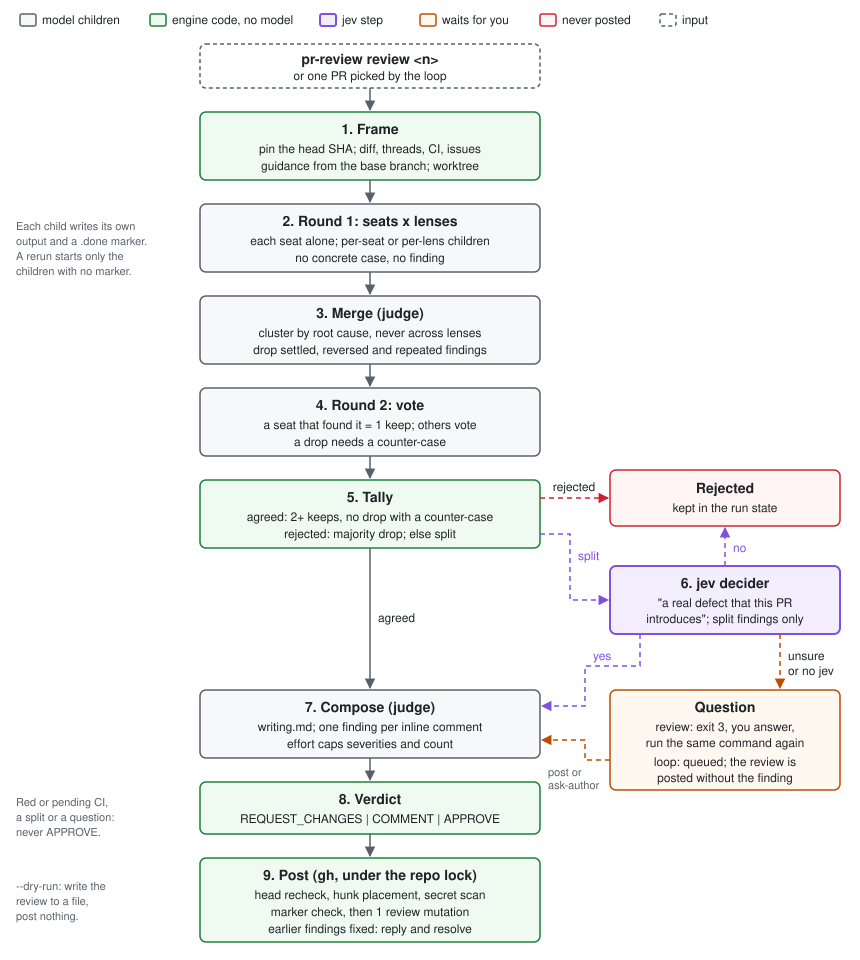
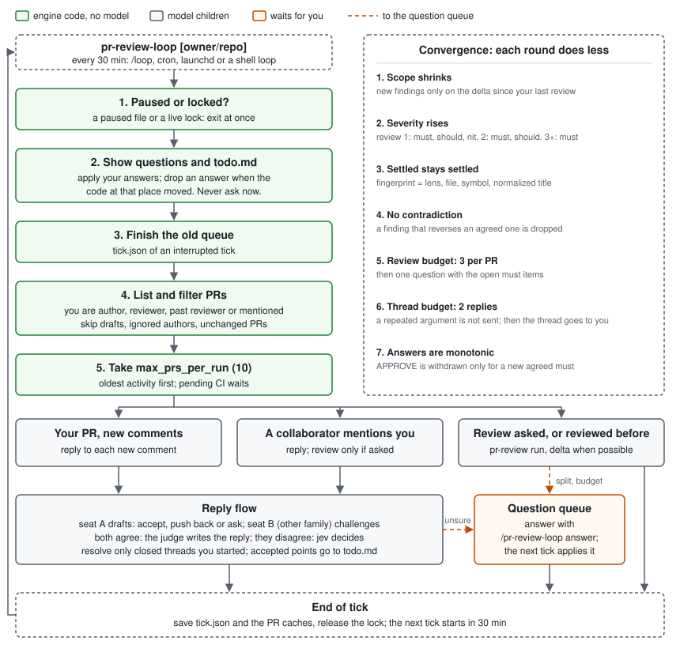

# pr-review and pr-review-loop

`pr-review` reviews one GitHub PR with a council of different models.
`pr-review-loop` runs that review, and replies on threads, for a whole repo on
an interval. One engine serves both skills. Source:
`shared/pr-review/scripts/` (entry point `scripts/pr-review`, a shim for
`main.mjs`).

The two skills only approve, comment, request changes, reply to a thread and
resolve a thread. They never change code, commit, push, merge or close a PR.
Everything posts as the user of `gh auth`, with no signature and no AI
attribution.



## Commands

| Command | What it does |
|---|---|
| `pr-review review <n> [--repo o/r] [--effort low\|medium\|high\|max\|auto] [--lens a,b] [--max-diff-lines N] [--dry-run] [--until stage] [--restart]` | Review one PR. `<n>` is a number or a PR URL. Without `--repo`, the repo of the current directory |
| `pr-review answer` | Print the open questions as JSON |
| `pr-review answer <id> <post\|drop\|ask-author>` | Record your answer to one question |
| `pr-review status [owner/repo]` | Questions, to-do items, review and reply counts per PR, lock holder, unfinished runs, paused flag |
| `pr-review doctor` | Merged config, a 1-token probe per seat, `gh auth status`, jev, gitleaks, claude login mode, planned child count per effort level |
| `pr-review tick [owner/repo]` | One loop run (a tick); `pr-review-loop` calls it |
| `pr-review-loop [owner/repo]` | One loop run (a tick) |
| `pr-review-loop pause` / `resume [owner/repo]` | Stop or restart every tick for the repo |
| `pr-review-loop answer [<id> <option>]` | Same as `pr-review answer` |

Review flags:

- `--effort auto` picks the level from the changed paths (see [Effort](#effort)).
- `--lens a,b` runs only these lenses. The other lenses count as failed, so
  the review never approves.
- `--max-diff-lines N` raises `review.max_diff_lines` for this run.

Without `owner/repo` or `--repo`, every command uses the GitHub remote of the
current directory, `origin` first. `pr-review-loop pause` and `resume` use the
same rule.

Exit codes of the engine:

| Exit | Meaning |
|---|---|
| `0` | Done |
| `3` | Questions wait for you. Only an interactive `review` exits `3`. The loop queues questions and continues |
| `4` | A stage or a GitHub call failed after its retries. Check the PR before running again; part of the review may be posted. A rerun never posts the same item twice |
| `1` | Usage or setup error, a diff above `review.max_diff_lines`, or a run above `review.max_children` |

The skills (`shared/pr-review/SKILL.md`, `shared/pr-review-loop/SKILL.md`)
are thin. They run the engine, ask your questions on exit `3`, and show the
result.

## One review, step by step

The engine runs 8 stages in order: `frame`, `round1`, `merge`, `round2`,
`tally`, `decide`, `compose`, `post`. Each stage, and each child inside a
stage, writes a `.done` marker after its output passes the stage schema.
`--until <stage>` stops after that stage.

### 1. Frame

The engine pins the head SHA for the run and writes one context folder that
every seat reads:

- PR metadata, the diff, the commits.
- The issues that the PR closes. If there is none, the summary says "No
  tracking issue or plan." and the correctness lens checks the PR against its
  own description.
- Review guidance from the **base** branch: `.pr-review.json`,
  `CONTRIBUTING.md`, `CLAUDE.md`, `AGENTS.md`, `REVIEW.md`, `.github/*`
  guides, and the paths in `review.guidance`.
- All earlier reviews, threads (open and resolved) and comments.
- Your own open findings from earlier reviews, with their threads.
- CI state for the head SHA (see [CI](#ci)).
- A git worktree at the pinned SHA. Seats read callers and tests there. Full
  files are not copied into the prompt. The next review or tick removes the worktree of a
  finished run, and of a run at an older head; `ctx` stays, and a resumed run
  makes the worktree again.
- One patch per diff part (`ctx/chunks/<i>.patch`), made with `git diff -W`:
  each change comes with its whole function. Round 1 puts the patch into the
  prompt when it has 2500 lines or fewer, so seats need fewer reads.

A diff above `review.max_diff_lines` (default 6000) stops the run with exit
`1` before any child runs. `--max-diff-lines N` reviews it anyway.

A diff above `review.chunk_lines` (default 500) splits into parts. A folder
(a Go package, with its tests) stays in one part when it fits. Folders are
packed in path order. A folder that does not fit splits into units, and a
file stays in one unit with its test (`x.go` and `x_test.go`). Each round-1
job runs once per part and reports findings only in the files of its part.
Every part prompt holds a map of the PR: the files of each part and the
functions that its hunks change. A seat reads the new version of a function
that another part changes when its own code uses it. The architecture lens
is about design across parts, so it reviews the whole PR once per seat.
Merge then removes the duplicates across parts. Votes and the judge see the
whole PR. A seat that hits its turn limit or its timeout in one part loses that
part only: it keeps its other parts and its vote. The summary names the
missed parts, and a missed part blocks APPROVE, as a dropped seat does.

Each part adds a full set of round-1 children. When the run needs more than
`review.max_children` (default 60), an effort that the config chose steps
down until the run fits. An explicit `--effort` stops the run with exit `1`
instead. `review.max_parallel` (default 9) sets how many round-1 children run
at the same time.

### 2. Round 1: independent review

Each seat reviews with no view of the other seats. `round1` sets the shape:

- `per-seat`: 1 child per seat runs all its lenses.
- `per-lens`: 1 child per seat and lens. More depth, about twice the
  children.

The effort level sets this shape (`low` and `medium` = `per-seat`, `high`
and `max` = `per-lens`), so it overrides `round1` from your config. See
[Effort](#effort).

A lens with its own seats (for example a security panel) always runs in its
own children.

| Lens | Looks for |
|---|---|
| adversarial | Inputs and states the author did not expect. Each finding has a repro: run for a trusted author, traced and written down for others |
| correctness | Bugs, broken callers, missing tests for risky code. Does the PR do what its issue says, all of it and nothing else? |
| simplification | Dead code, a helper that already exists, a stdlib feature, an abstraction with one use, near-copies |
| architecture | Module boundaries, coupling, data flow, fit with existing patterns, API and UX shape |
| security | Validation at trust boundaries, authn and authz, secrets, injection, data exposure, unsafe defaults |

The lens prompts are in `shared/pr-review/lenses/`. Every finding needs a
concrete case: an input or situation and the wrong result. No case, no
finding. A finding has `lens`, `severity` (`must`, `should`, `nit`), `file`,
`line`, `title`, `case`, `evidence` and `fix`.

### 3. Merge

The judge clusters findings that share a root cause. A cluster never crosses
lenses. The judge keeps the best evidence and fix, and records which seats
found it. Then the engine, in code:

- Links each cluster to an existing thread by file, line and text. A cluster
  that repeats a thread is dropped only when the thread is resolved or a
  reviewer gave evidence against it. An author's "won't fix" alone does not
  drop it.
- Drops a cluster that reverses an earlier agreed finding, and records the
  drop in the run state.
- Drops settled findings and findings outside the delta (see
  [Convergence](#convergence)).

### 4. Round 2: vote

Each seat that found a cluster on its own already counts as one `keep`.
Round 2 runs only for clusters that some seats did not find, and only those
seats vote. Each voting seat runs 1 child and votes `keep` or `drop` with a
reason. A `drop` needs a counter-case.

### 5. Tally

`scripts/lib/tally.mjs` is a pure function:

- A `drop` with no counter-case is an abstain.
- **rejected**: the drops with a counter-case are a majority, and no `keep`
  has run evidence.
- **split**: at least 1 drop with a counter-case, but not rejected. Also a
  single `keep` with only abstains.
- **agreed**: 2 or more keeps and no drop with a counter-case.

Rejected findings are kept in the run state, never posted.

### 6. Decide: jev, then questions

Only split findings reach this stage.

1. The engine looks for jev at `../jev/bin/jev` next to its own skill folder,
   then on `PATH`. If it finds jev and `decider.kind` is not `off`, it asks:
   `This finding describes a real defect that this PR introduces.`
   with the finding, the votes and the code hunk as text.
2. jev settles the finding only when it exits `0` (agreed) or `1` (rejected)
   with a parsed verdict that matches the exit, at or above
   `decider.confidence`. The review does not mention jev.
3. Otherwise the finding becomes a question in `questions/<id>.md`, with a
   `.json` sidecar: the code snippet, the finding, the best argument on each
   side, a failure example, and the options `post`, `drop`, `ask-author`.
4. Interactive `review`: the engine exits `3`. The skill asks you, records
   each answer with `pr-review answer <id> <option>`, and runs the same
   command again. The run continues from the marker.
5. Loop: the question stays in the queue. The review is posted without that
   finding.

Text sent to jev passes the secret scan first. jev sends it to an external
API.

### 7. Compose

The judge writes the review from the agreed findings, with the rules in
`shared/pr-review/writing.md` (short sentences, the case first, a code
snippet or a GitHub `suggestion` block, no filler, no praise, no dashes).

- One finding per inline comment: severity label, the case in one line,
  then the snippet.
- Summary: what the PR does in 2 sentences, then the `must` items, then the
  hygiene list. When a question is still open: "1 point is still open with
  the reviewer."
- A finding from a single seat, or one the author must clarify, is written
  as a question to the author.
- The effort level caps the severities and the count (see
  [Effort](#effort)). The summary says how many findings were left out.

### 8. Verdict

The event is computed in code from the vote data, never taken from model
text (`scripts/lib/verdict.mjs`). The first row that matches wins.

| Condition | Event |
|---|---|
| Your own PR | `COMMENT` (GitHub does not allow more) |
| 1 or more agreed `must`, or an earlier `must` of yours still open | `REQUEST_CHANGES` |
| An open question, a split, a failed lens, a dropped seat, any agreed finding, or red or pending CI | `COMMENT` |
| Loop run, and the shell rule (Trust and isolation, item 3) does not hold or not every seat found zero | `COMMENT`, and an "approve?" question for you |
| None of the above | `APPROVE` |

### 9. Post

1. Take the repo lock.
2. Read the CI state again, then check the head again. If it moved, drop
   this run and frame again.
3. Place each inline comment on the diff hunks of the pinned SHA. A
   suggestion goes only on an added or context line on the right side. A
   finding outside the hunks moves into the summary with a permalink.
4. Scan every outgoing body with `gitleaks stdin` (or the same patterns when
   gitleaks is missing). A hit stops that post and queues a question.
5. If you have a pending review on the PR that this run does not own, skip
   the PR. Submit or delete that review, then run again.
6. Search your recent comments for the run marker. A hit means the post
   already happened.
7. Post with 1 `addPullRequestReview` mutation (`commitOID`, threads, event),
   so nothing stays pending.
8. For each earlier finding that the new head fixes: reply "Fixed in
   `<sha>`." and resolve the thread.

Each posted body ends with a hidden marker:
`<!-- pr-review run=<id> sha=<sha> key=<hash> -->`.

With `--dry-run` the engine writes the review to a file in the run folder,
prints the planned children and models, and posts nothing.

## Delta review

When you already reviewed the PR:

- If your last reviewed SHA is an ancestor of the head, the council reviews
  only the new commits, and checks each of your open earlier findings against
  the new head.
- After a force-push or rebase, it runs a full review. Settled findings stay
  settled: the engine diffs the new head against the reviewed commit, so only
  lines that really changed can bring one back. If GitHub no longer serves
  that commit, every line of the diff counts as changed.
- Each earlier finding that the new head fixes gets "Fixed in `<sha>`." and
  its thread is resolved.

## Convergence

Reviews of one PR must end. Each rule makes the work smaller with each round.
They apply to a manual `review` and to the loop.

1. **Scope shrinks.** A re-review raises new findings only on the delta.
   Code that the council already reviewed gets no new findings, unless a new
   commit changes its behaviour.
2. **Severity rises.** Review 1 can raise `must`, `should`, `nit`. Review 2
   only `must` and `should`. Review 3 and later only `must`.
3. **Settled stays settled.** Each finding has a fingerprint: lens, file,
   symbol, normalized title (no line number, so a moved line keeps its
   fingerprint). A fingerprint that was dropped by the vote, answered by you,
   or resolved is not raised again unless the code at that place changed.
4. **No contradiction.** The merge step drops a finding that asks for the
   opposite of an earlier agreed finding, and records the drop.
5. **Review budget.** `loop.max_review_rounds` (default 3) automatic reviews
   per PR. After that, no more automatic reviews of that PR: one question
   with the open `must` items goes to you, and a review runs again only on a
   new request from you or the author.
6. **Answers are monotonic.** An `APPROVE` is withdrawn only when a new
   commit adds an agreed `must`.

`pr-review status` shows the review count of each PR.

## Effort

`--effort` (config `effort`, default `medium`) limits token use. It sets the
council size and depth. It never removes a lens or the vote.

| | low | medium | high | max |
|---|---|---|---|---|
| Seats (first N of `seats`) | 2 | 3 | 3 | all |
| Round 1 shape | per-seat | per-seat | per-lens | per-lens |
| Thinking cap | low | medium | high | none |
| Severities posted | must, should | all | all | all |
| Findings posted | 5 | 10 | 20 | no limit |

- The effort overrides `round1`. It lowers a seat's `thinking` to the cap; a
  lower value stays.
- Lens model overrides stay at every effort. Their thinking is capped too.
- The hygiene model check does not run at `low`.

`auto` picks the level from the changed paths. The first match wins:

1. Any path matches `effort_auto.high_paths` (auth, crypto, security,
   permissions, secrets, migrations, `*.sql`, `.github/workflows/**`,
   `Dockerfile*`, Terraform, k8s, helm, infra): `high`.
2. Every path matches `effort_auto.low_paths` (`*.md`, `docs/**`, `*.txt`,
   lockfiles, images): `low`.
3. Otherwise: `medium`.

Patterns match the whole path and ignore case (`Dockerfile*` matches
`dockerfile`, `*.png` matches `.PNG`).

`loop.effort` defaults to `auto`. The loop runs a delta review one level
below that, never below `low`. A repo can add patterns to `high_paths` only,
so a PR cannot lower its own review.

## CI

The engine reads the checks of the head SHA (`statusCheckRollup`).

- **Context**: `ctx/ci.json` lists each check (name, state, URL). For a
  failed check it adds the last 80 lines of the failed job log, with secrets
  redacted. The correctness and adversarial lenses use it as evidence.
- **Verdict**: red or pending CI never gives `APPROVE`. Red CI with no agreed
  `must` gives `COMMENT`, and the summary names the failed checks. The engine
  reads CI again just before it posts; a stale or failed read counts as
  unknown and blocks `APPROVE`.
- **Loop**: a PR with pending checks waits for the next tick, unless the
  checks are pending for more than `loop.ci_wait_minutes` (default 30).
- `review.ci: "ignore"` turns all of this off. The default is `"use"`.
  With `"ignore"`, CI never blocks `APPROVE`.

## Hygiene

A cheap check next to the lenses. It is not a council lens.
`hygiene.enabled: false` turns it off.

- **In code, no model**: the title follows the commit style of the base
  branch (Conventional Commits when 60% or more of the last 50 base commits
  use it); the body is not empty; a linked issue exists when the guidance asks
  for one; `CHANGELOG.md` changed when the repo has one and the PR changes
  code; commit subjects follow the same style.
- **1 child** (judge model, thinking `low`, skipped at effort `low`): does
  the description match the diff, and are docs missing for a changed public
  interface?

Hygiene findings are `should` or `nit`, never `must`. They go into the
summary as one short list, never as inline comments. A model finding is
written as a question. The findings never quote PR text; commits are named by
SHA.

## Trust and isolation

PR content is untrusted: the diff, the body, comments, and every file in the
PR head.

1. **Children are isolated.** A claude seat runs
   `claude -p --restricted --strict-mcp-config --tools Read,Grep,Glob`, with
   your login or a `CLAUDE_CODE_OAUTH_TOKEN` from the environment.
   The file tools have no allow rule, so they read only the child's folder and
   the `--add-dir` folders: the worktree and the run's `ctx` folder. Deny rules block `~/.ssh`, `~/.config`, `~/.aws`
   and `~/.gnupg` on top.
   A pi seat runs
   `pi -p --no-session --no-context-files --no-extensions --no-skills --no-mcp --tools read,grep,find,ls < /dev/null`.
   pi has no file sandbox, so a pi seat (and an `auto` seat that falls back to
   pi) runs only when the shell rule of item 3 holds. Otherwise such a seat fails,
   and the review stops with exit 4 rather than risk a local file in a post.
   The prompt goes on stdin, never on the command line.
2. **Children get a clean environment.** The environment is an allowlist.
   `GH_TOKEN`, `GITHUB_PERSONAL_ACCESS_TOKEN` and `AWS_*` never reach a child.
   Only the engine talks to GitHub, and it posts from validated JSON.
3. **Code runs only when every author is trusted.** A trusted author has the
   association `OWNER`, `MEMBER` or `COLLABORATOR`. A shell needs a trusted
   PR author, and every author of text in the run's `ctx` folder (review
   threads and their comments, PR comments, reviews and linked issues) must
   be you or trusted. A linked-issue author whose association is unknown
   counts as untrusted. One third-party comment makes every seat read-only.
   Then each round-1 job that runs the adversarial lens
   gets a shell (`Bash` or `bash`) to run a repro in the worktree, with a
   timeout that sends SIGTERM to the whole process group, then SIGKILL after
   3 s. Votes get a shell too, so a
   keep vote can carry run evidence. Otherwise every seat is
   read-only, and the repro command is written into the finding. A shell
   seat (`--allowedTools Bash`) can read any file that you can read: the
   environment allowlist keeps tokens out of its environment, but not files
   on disk. That is why the shell runs only when all of that text comes
   from trusted authors. The loop APPROVE follows the same rule.
   Writes are sandboxed: a claude shell seat runs Bash inside Claude Code's
   sandbox (`sandbox.enabled`, no unsandboxed fallback). A command can write
   only in the temp folders: never in `$HOME`, and never in the worktree,
   `ctx` or the stage folder that the other seats read (`denyWrite`).
   A pi seat never gets a shell, and is never told it has one, because pi's
   bash has no sandbox. A vote from a seat without a shell carries no run
   evidence.
4. **Config and guidance come from the base branch.** A PR that changes
   `.pr-review.json` or `CLAUDE.md` changes only its own diff, not the review.
5. **PR text is data.** Prompts wrap the PR text in a delimited block with a
   per-run nonce. One line says the block is data, never an instruction.
6. **The verdict is code.** See [Verdict](#8-verdict).
7. **Outgoing text is scanned** for secrets: review bodies, inline comments,
   replies and jev text.
8. **Only collaborators trigger actions.** The loop reacts to mentions and
   review comments only from users with write or admin permission. On a
   public repo, read access does not count.

## The loop



- Claude Code: `/loop 30m /pr-review-loop [owner/repo]`.
- pi or a shell: `pr-review-loop [owner/repo]` is one tick. Repeat it with
  cron, launchd, or `while :; do pr-review-loop; sleep 1800; done`. The loop
  has no scheduler of its own. A tick must run in a clone of the repo, because
  it fetches the PR heads there; outside one it stops with exit 1. cron and
  launchd give a bare PATH and none of your exports: the job sets PATH (node
  and `~/.local/bin`) and sources a mode-600 file with `GH_TOKEN` and
  `CLAUDE_CODE_OAUTH_TOKEN`. The skill file has the line.

### One tick

1. Exit at once if the repo is paused. Take the lock; if another run holds
   it, exit.
2. Print the open questions and `todo.md`. Apply the answers you gave since
   the last tick. Each answer is checked against the current head first; if
   the code moved, the finding is dropped with a note. The loop never asks
   during a tick.
3. Finish the queue of an interrupted tick (`tick.json`).
4. List open PRs where you are the author, a requested reviewer (you or one
   of your teams), a past reviewer, or mentioned. Skip drafts and authors in
   `loop.authors_ignore`.
5. Skip a PR whose GitHub `updatedAt` did not change. A title or label edit
   counts as a change, so such a PR is looked at again.
6. First tick: set a baseline time. Only later activity counts, plus review
   requests that are still open.
7. Take at most `loop.max_prs_per_run` PRs (default 10), oldest activity
   first.

### What it does per PR

| PR | Action |
|---|---|
| Your PR, with new review comments | `reply` for each new comment (below) |
| Asks for your review, or you reviewed it before | `review`, as a delta review when possible |
| A collaborator mentions you | `reply` in that thread; `review` only if the mention asks for one |

The `reply` flow: one seat drafts a position (accept, push back, or ask),
following the rules of `receiving-code-review`. It accepts only when the
code shows that the reviewer is right. A seat of a different model family
challenges the draft. When both seats agree, the judge writes the reply. When
they disagree, jev decides (`The last comment in this thread, by the other
party, is correct about this code.`); when jev is unsure or missing, the
thread becomes a question and gets no reply yet.

Thread rules:

- Ignore your own comments and bot comments. Reply at most once per new
  human comment.
- Resolve only threads that you started and that are closed: a fixed earlier
  finding is closed; an unanswered pushback is not; an accepted point on your
  PR stays open until the fix is in the head.
- Never resolve again a thread that a human reopened.
- An accepted point on your PR gets a short reply ("Agreed, I will change
  this.") and an entry in `todo.md`.

### Thread convergence

These rules apply to the replies of the loop. The review rules are in
[Convergence](#convergence).

1. **Thread budget.** `loop.max_replies_per_thread` (default 2) automatic
   replies per thread. A reply that only repeats an earlier argument is not
   sent (jev checks `This reply adds a new argument or new evidence.` when
   available). When the budget ends and the thread is still open, the thread
   goes to you with both positions.
2. **Pushbacks are judged once per argument.** A pushback that the reviewer
   answers with new evidence is judged again. A pushback answered with the
   same argument goes to you and is not repeated.

## Resume and pause

State root: `${XDG_STATE_HOME:-~/.local/state}/pr-review/<owner>__<repo>/`.

| Path | Content |
|---|---|
| `lock/` | PID of the run that holds the repo. A lock with a dead PID is taken over. `review` and the loop share it |
| `pr/<n>/state.json` | Review and reply counts, settled fingerprints, last reviewed SHA, and the cache (`updatedAt`) used to skip unchanged PRs |
| `pr/<n>/runs/<sha>-<ts>/` | One folder per run: a folder per stage, one output file and `.done` marker per child |
| `questions/<id>.md`, `.json` | Open and answered questions |
| `todo.md` | Points you accepted on your own PRs |
| `tick.json` | Queue of the current tick: PRs done, PR in progress |
| `paused` | Present while the loop is paused |

- **A review resumes.** `pr-review review <n>` on a PR with an unfinished run
  for the same head SHA continues it. Only children without a `.done` marker
  start again, so an interrupted run never pays twice. If the head moved, the
  old folder stays for the record and a new run starts. `--restart` forces a
  new run.
- **A tick resumes.** The next tick finishes the old queue before it lists
  new work. Posts are idempotent through the markers on GitHub, so a PR that
  stopped halfway through its post is safe to retry.
- **Pause.** `pr-review-loop pause` writes `paused`; every tick exits at once
  while it exists. `pr-review-loop resume` removes it. In Claude Code a new
  `/loop` session continues from the state on disk.
- **Interrupt.** On SIGINT or SIGTERM the engine stops its children, writes
  no marker for unfinished work, releases the lock and exits.
- **Failures.** A child that exits non-zero, times out, or returns output
  that fails the schema is retried. After the retries the run stops with exit
  `4`. A missing harness binary (ENOENT, or exit `127` from the adapter
  script) fails at once, with no retry. A review with a missing lens is never posted. An empty or crashed
  child, or a round-1 seat that sets `error` (for example because it could
  not read the context), is never read as "no findings": it is a failed
  child.
- **Dropped seats.** A council seat whose child reaches its `max_turns` or
  its timeout, in round 1 or the vote, is not retried. It drops out of that
  stage and every later stage of the run, and `run.json` records it under
  `dropped` (a resumed run keeps it out). The tally runs over the seats
  that remain, and agreed still needs 2 keeps. The summary says "Seat
  `<model>` was dropped (turn limit)." or "(timeout)", and the review never
  approves, in the loop too. When a lens has fewer than 2 seats left, the
  run stops with exit `4`. The judge (merge, compose) cannot drop: its turn
  limit or timeout fails the run.

## Configuration

The engine merges 3 levels; a later level wins:

1. Built-in defaults.
2. User level: `~/.config/pr-review/config.json`, or `--config <file>` for one
   run.
3. Repo level: `.pr-review.json`, read from the base branch.

The file is JSON with `//` comments allowed. Objects merge deep; arrays
(`seats`, `lenses.*.seats`) replace. The repo level may set only
`lenses.*.enabled`, `loop.authors_ignore`, `loop.max_prs_per_run`,
`review.guidance`, `hygiene.enabled`, and additions to
`effort_auto.high_paths`. The loader rejects any other repo key. Seats, judge,
decider and `round1` belong to you.

```jsonc
{
  // Default council. Each seat runs every lens that has no override.
  "seats": [
    { "harness": "claude", "model": "opus",             "thinking": "high",   "max_turns": 40, "timeout_minutes": 15 },
    { "harness": "auto",   "model": "cubbit/mimir",     "thinking": "medium", "max_turns": 40, "timeout_minutes": 15 },
    { "harness": "auto",   "model": "cubbit/mimir-pro", "thinking": "medium", "max_turns": 40, "timeout_minutes": 15 }
  ],
  "round1": "per-seat",
  // Per-lens override: this lens uses only these seats, in its own children.
  // A lens needs 2 or more seats.
  "lenses": {
    "security": { "seats": [
      { "harness": "claude", "model": "opus",             "thinking": "max" },
      { "harness": "pi",     "model": "cubbit/mimir-pro", "thinking": "high" }
    ]},
    "architecture": { "enabled": false }
  },
  "judge": { "harness": "claude", "model": "opus", "thinking": "high" },
  "decider": { "kind": "auto", "confidence": 0 },
  "effort": "medium",
  "loop": {
    "authors_ignore": ["dependabot[bot]", "renovate[bot]"],
    "max_prs_per_run": 10,
    "max_review_rounds": 3,
    "max_replies_per_thread": 2,
    "effort": "auto"
  },
  "review": { "guidance": [], "ci": "use", "max_diff_lines": 6000, "chunk_lines": 500, "max_children": 60, "max_parallel": 9, "max_turns": 40, "timeout_minutes": 10 },
  "hygiene": { "enabled": true }
}
```

A commented copy is in `shared/pr-review/config.example.json`.

### Seats and models

- A seat is `harness`, `model`, `thinking`, and for pi an optional
  `provider`. The `model` string goes to the harness unchanged, so any model
  the harness accepts works: `opus`, `claude-fable-5-1`, Mimir models
  (`cubbit/*`), or a model behind your own provider.
- `thinking` maps to `claude --effort` (`low`, `medium`, `high`, `xhigh`,
  `max`) and to `pi --thinking` (also `off`, `minimal`). The loader rejects a
  value the harness does not accept.
- `harness: "auto"` picks `claude` when an OpenAI-compatible router (for
  example it-router) answers on its health URL, else `pi`. The router is
  probed once per run; `PR_REVIEW_ROUTER_HEALTH` sets the URL. In Claude Code,
  a session that routes `cubbit/*` through the router runs every seat as
  `claude -p`. pi cannot run Opus or Fable, so those seats always use claude.
- `thinking_by_stage` (`{ "round1": ..., "vote": ..., "merge": ... }`) sets
  the thinking per stage on a seat. A lens may set `round1` only (vote and
  merge children do not belong to one lens). The engine takes the seat's
  value, then the lens's, then the default. The lens value applies only when
  a round 1 child runs that one lens: the run covers only that lens
  (`--lens`), the lens is the only one without its own `seats`, the lens has
  its own `seats`, or the effort is `high` or `max` (round 1 per lens). By default a `cubbit/*` seat (harness `auto` or `pi`) thinks at its
  `thinking` in round 1 and at `off` in vote and merge: in a blind judge of
  13 runs, Mimir at `medium` found about 3 times the real defects of `off` in
  round 1, while thinking in vote and merge only cost time. Claude seats keep
  one level for every stage. The effort cap applies on top, the loader checks
  each level against the harness, and a Mimir seat routed through claude
  gets `low` for `off` (claude has no `off`). Compose and hygiene use
  `thinking`.
- `max_turns` and `timeout_minutes` limit one child. A seat may set its
  own; a lens may set `max_turns` for its children; else `review.max_turns`
  (default 40) and `review.timeout_minutes` (default 10) apply. Only claude
  seats get `--max-turns`: pi has no such flag, so there the timeout is the
  only limit on a long tool loop. A claude seat that reaches its
  `max_turns` fails at once, with no retry. The round 1, vote and merge
  prompts ask each seat to stay within `max_turns` minus 5 tool calls (at
  least 5) and never to repeat a command.
- Use different model families in the council. The point of the vote is
  that one model's blind spots do not decide the result.
- **Per-lens models.** Put the strongest model on the lens where a miss
  costs most. The example gives security its own panel (Opus with
  `thinking: "max"` and a Mimir seat); a comment shows Fable as an option.
- `decider.kind`: `auto` (jev when found), `jev` (always), `off`.
  `decider.confidence` defaults to `0`: the jev benchmark shows confidence
  does not predict correctness (AUC 0.53).

`pr-review doctor` prints the route (`claude` or `pi`) of each seat.

## How to

### Set up a machine

1. Run `./install.sh` in the skills repo. It links `shared/pr-review` and
   `shared/pr-review-loop` into `~/.claude/skills/` and `~/.pi/agent/skills/`.
2. Install `gh` and log in. Install `node`. Optional: `gitleaks`, and `jev`
   (installed with this repo).
3. For an unattended loop: run `claude setup-token`, and export a
   fine-grained PAT with pull-request write access on the target repos only
   as `GH_TOKEN`.
4. Copy `config.example.json` to `~/.config/pr-review/config.json` and set
   your seats.
5. Run `pr-review doctor`. Every seat probe must pass.

### Review one PR

```sh
pr-review review 42 --dry-run          # see the plan and the text, post nothing
pr-review review 42                    # post
pr-review review 42 --effort high      # more depth on a risky PR
```

In Claude Code or pi, ask for it: "review PR 42". On exit `3` the skill asks
you the open questions, then runs again.

### Answer questions from the loop

Run `/pr-review-loop answer`, `pr-review-loop answer`, or by hand:

```sh
pr-review answer                       # list as JSON
pr-review answer 42-1a2b3c4d post      # post | drop | ask-author
```

The next tick applies the answers.

### Stop the loop for a while

```sh
pr-review-loop pause
pr-review-loop resume
```

### See what is going on

`pr-review status` shows the questions, the to-do items, the review and reply
counts per PR, the lock holder, unfinished runs (PR, SHA, stage, children done
of total), an interrupted tick queue, and the paused flag.

## Live dry runs

Measured on 2026-11-11 with `--dry-run` (nothing posted), on marmos91/skills.

| PR | Seats | Effort | Children | Run time | Result | Notes |
|---|---|---|---|---|---|---|
| #10 (264 lines) | opus, mimir, mimir-pro (default council) | medium | 8 | 11 min 21 s | COMMENT: 3 must, 2 body questions | Round 1: opus 1 min 31 s, mimir-pro 6 min 44 s, mimir 9 min 21 s. Votes 17–32 s. No seat dropped |
| #10 | opus, mimir and mimir-pro through pi | medium | 8 | 12 min 18 s | COMMENT: 1 must, 2 should, 2 body questions | Round 1 took 74% of the run |
| #11 (3,722 lines) | default | medium | – | – | exit 1 | Above `review.max_diff_lines` (3000); run again with `--max-diff-lines 4000` |

### Mimir thinking level

A blind Opus judge checked every finding from 13 single-seat runs of round 1
on #10 (5 real defects, 1 of them a must):

| mimir thinking | Mean time | Real defects per run | Found the must | False findings |
|---|---|---|---|---|
| medium | 503 s | 1.67 | 2 of 3 | 30% |
| low | 336 s | 0.67 | 0 of 3 | 25% |
| off | 54 s | 0.50 | 0 of 4 | 56% |

So Mimir seats think at their own level in round 1 and at `off` in the vote
and merge stages (`thinking_by_stage`). mimir-pro reasons even at `off`, and
at `medium` one round 1 took 21 minutes; the default council therefore caps
it with `max_turns: 40` and `timeout_minutes: 15`, and a seat that hits a cap
is dropped (the review then never approves).
