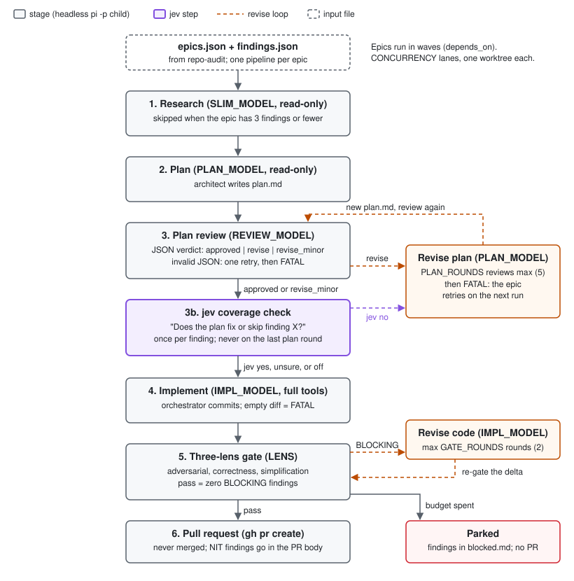

# The repo-audit-fix pipeline

`repo-audit-fix` turns each epic from `repo-audit` into one pull request.
Source: `shared/repo-audit-fix/scripts/fix.sh`.

## Scheduling

1. `fix.sh plan` reads `epics.json` and `findings.json` from `AUDIT_STATE`.
2. It matches GitHub issues (label `audit`) to epics by exact title. A match adds `Fixes #N` to the PR.
3. It sorts the epics into waves from `depends_on`. It writes `.fix/plan.json`.
4. `fix.sh run` runs the waves in order.
5. Inside a wave, up to `CONCURRENCY` epics run at the same time. A new epic starts when a lane is free.
6. Each epic gets its own git worktree under `FIXROOT` and a branch `fix/audit-<epic>`.
7. If a dependency branch exists, the new branch starts from it. Otherwise it starts from `BASE_REF`.

## Stages of one epic

Each stage writes a marker file in `$FIXROOT/.fix/<epic>/`.
A new run skips every stage that has its marker.
A crashed child writes no marker, so the next run retries that stage.

| # | Stage | Model | Tools | Marker |
|---|---|---|---|---|
| 1 | Research | `SLIM_MODEL` | read-only | `research.md` |
| 2 | Plan | `PLAN_MODEL` | read-only | `plan.md` |
| 3 | Plan review + jev check | `REVIEW_MODEL` + `jev` | read-only | `plan-approved` |
| 4 | Implement | `IMPL_MODEL` | read, write, edit, bash | `implemented` |
| 5 | Three-lens gate | `REVIEW_MODEL` via `LENS` | read, bash | `gate-passed` |
| 6 | Pull request | `gh` | | `pr-url` |

### 1. Research

1. The scout reads `epic.json` and confirms each finding in the source.
2. It marks wrong findings `SKIP`.
3. It classifies each finding: logic (needs a test) or mechanical (no test).
4. If the epic has 3 findings or fewer, this stage is skipped. The architect checks the findings.

### 2. Plan

The architect writes `plan.md`: files, the fix per finding, design, tests, ordered steps, and verification commands.

### 3. Plan review and the jev coverage check

1. The reviewer returns JSON: `{"verdict": "approved"|"revise"|"revise_minor", "blocking": [...], "nits": [...]}`.
2. Invalid JSON gets one retry. A second failure is FATAL.
3. If the verdict is not `revise` and this is not the last round, jev checks each finding. See [jev.md](jev.md).
4. A jev "no" adds a blocking comment and changes the verdict to `revise`.
5. `approved`: the plan passes.
6. `revise_minor`: the plan passes. The nits go to the implementer.
7. `revise`: the architect rewrites only the parts named in the blocking comments. The new plan goes back to step 1.

### 4. Implement

1. The implementer follows the plan in the epic worktree.
2. It adds only the tests the plan names.
3. It runs the plan's lint, typecheck, and test commands.
4. It never commits. The orchestrator commits.
5. An empty diff is FATAL.

### 5. Three-lens gate

1. `fix.sh` runs `$LENS <lens> <BASE_REF>...<branch>` for three lenses in parallel: `adversarial`, `correctness`, `simplification`.
2. Each lens tags findings `- BLOCKING ...` or `- NIT ...`.
3. The gate passes when no lens reports a BLOCKING finding. NIT-only output passes.
4. A lens that fails or times out fails the gate.
5. On a failure, the implementer gets the BLOCKING findings only, and fixes them.
6. From round 2, each lens gets `LENS_PRIOR` (its last BLOCKING findings) and `LENS_DELTA` (`<gate-sha>..<branch>`).
   The lens checks the old findings first. It raises new findings only inside the delta.

### 6. Pull request

1. `fix.sh` pushes the branch and runs `gh pr create`.
2. The PR body has the epic, the goal, `Fixes #N`, and the gate NITs.
3. If an open PR for the branch exists, `fix.sh` uses it.
4. The engine never merges. You merge.

## Convergence limits

| Limit | Default | What it counts | When spent |
|---|---|---|---|
| `PLAN_ROUNDS` | `5` | Plan reviews in one run | FATAL: "plan review loop exhausted". The next run starts the count again. |
| `GATE_ROUNDS` | `2` | Code revise rounds, counted from `revise-r*.md` on disk | Parked |
| jev flags | 1 per finding | Ids in `jev-flagged` | The finding is not checked again |

The gate runs at most `GATE_ROUNDS + 1` times.
The gate round count is on disk, so a restart does not reset it.

When an epic is parked:

1. Its open BLOCKING findings go to `.fix/<epic>/blocked.md`.
2. Its name goes to `.fix/blocked`.
3. Its lane is freed. Other epics continue.
4. A new run keeps it parked. To retry, raise `GATE_ROUNDS` and run again.

## State files

| File | Content |
|---|---|
| `.fix/RESUME.md` | Stage markers per epic, failures, and the resume command |
| `.fix/<epic>/plan-review.json` | Last plan review verdict |
| `.fix/<epic>/jev-flagged` | Finding ids jev flagged |
| `.fix/jev-down` | Present after a jev outage in this run |
| `.fix/<epic>/gate-<lens>.txt` | Last output of each lens |
| `.fix/<epic>/gate-nits.md` | NITs for the PR body |
| `.fix/<epic>/blocked.md` | Open findings of a parked epic |
