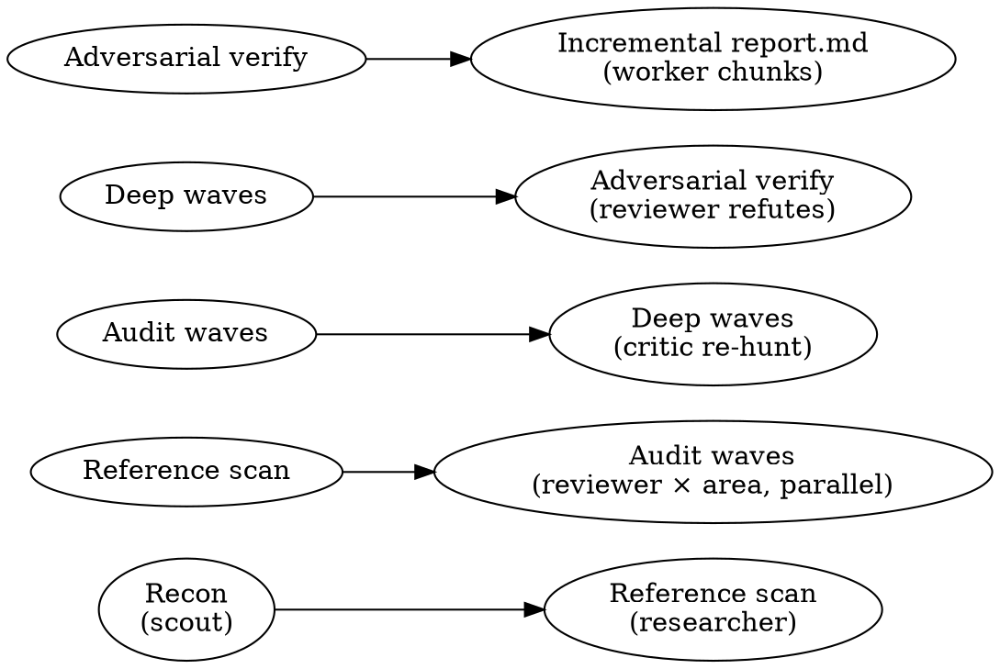

# Auditing AI-Developed Codebases

## Overview

AI-written code has characteristic failure modes: hallucinated APIs and dependencies, plausible-but-wrong logic, fabricated test assertions, stubs passing as done, over-engineered abstractions, redundant narration comments, and silent gaps versus how the real/official product behaves. This skill runs a **multi-agent, multi-wave audit** that hunts these systematically, **adversarially verifies** every finding, and writes a severity-classified `report.md`.

**Core engine:** a pi-subagents `workflowScript` (`audit-workflow.js` in this skill dir) fanned out through the `subagent` tool. This skill tells you HOW to drive it.

**Hard requirement:** multi-agent and token-heavy by design. Only run when the user asked for an audit/review of the whole repo (that opt-in counts). Confirm scale before launching if the repo is large.

## When to use

- Auditing a repo (or a large subsystem) that was mostly AI-generated.
- A deep, broad review across **correctness, security, AI-slop/hallucination, dead-code/over-engineering, useless comments, performance, structure/idiom best-practices, and feature-gaps vs reference implementations**.

**Not for:** reviewing a single small diff. Use this when breadth and multiple independent perspectives matter.

## The audit dimensions

Every finding is tagged with one dimension. Waves rotate through these so each wave hunts a **different bug class**:

| Dimension | What the finder hunts |
|-----------|----------------------|
| `bugs` | Logic errors, edge cases, race conditions, nil/None derefs, broken error handling, off-by-one, resource leaks |
| `security` | Injection, hardcoded secrets, auth/authz gaps, unsafe deserialization, path traversal, SSRF, vulnerable deps |
| `slop` | Hallucinated APIs/deps/imports, invented functions, fabricated/no-op test assertions, stubs/TODOs masquerading as done, plausible-but-wrong logic, copy-paste drift |
| `bloat` | Dead code, unused abstractions, speculative generality, duplication, needless indirection, over-engineering |
| `comments` | Redundant comments restating code, AI-narration ("Now we loop over..."), stale/misleading comments, commented-out code |
| `perf` | Hot-path allocations, N+1 queries, O(n²) where O(n) exists, unbounded buffers, missing streaming/pooling, redundant recomputation |
| `structure` | Design-pattern & language best-practice enforcement — idioms, patterns, anti-patterns for the **detected language(s)**. Flags SOLID violations, god objects, leaky abstractions, wrong-layer logic, missing canonical patterns. |
| `gaps` | Missing features / wrong behavior vs the official or reference implementation of this product class (found via web search) |

## Workflow



1. **Detect repo + scale.** Confirm the target path (default: cwd). Ask roughly how thorough — quick / standard / deep — only if unclear; default standard.
   - **Stack guidance:** if any installed stack skill matches the detected language (e.g. a Go idiom skill), read it and paste its key rules into `CONFIG.stackGuidance`. This sharpens the `structure` lens.
2. **Run the workflow.** Call the `subagent` tool ONCE with `workflowScriptPath` pointing at this skill's `audit-workflow.js`, `cwd` set to the target repo, `async: false` (the parent must block to summarize), `maxSubagentSpawnsPerRun` high enough (see Scaling), and `timeoutMs` generous (3000000+ for standard). The script:
   - **Recon** — a cheap `scout` sizes the repo; a second `scout` maps stack, frameworks, product type, per-stack idiom rules, and partitions the codebase into independent **focused areas** (~3k LOC each), tagged by importance. Multi-module & deployment coverage: every build root (`go.mod`/`package.json`/etc.) and deployment surface (Dockerfiles, k8s/, Helm, deploy/) MUST be its own area. **Pinned areas:** deployment/operator areas and `critical`-tagged areas survive the fan-out cap; only lower-importance non-pinned overflow is dropped.
   - **Reference scan** — a `researcher` web-searches for the official/canonical implementation of this product class and produces an expected-behavior checklist (feeds the `gaps` lens).
   - **Audit waves** — for each **dimension lens**, fan out one `reviewer` finder **per area in parallel** via `runs.all`. Distinct lens per wave ⇒ distinct bug classes.
   - **Deep waves (ON BY DEFAULT)** — a critic re-hunts cross-file/integration bugs the scoped finders structurally miss, deduping against everything already seen. Disable with `deepRounds: 0`.
   - **Adversarial verify** — every fresh finding gets independent `reviewer` skeptics prompted to **refute** it; confirmed only if it passes ALL THREE: (1) confirmed from source, (2) **reachable in production** (non-test caller exists; dead/test-only → refuted as `bloat`), (3) **not spec-correct behavior**. Kills hallucinated, dead-code, and spec-misreading findings.
   - **Incremental report** — report-init writes the header + summary tables, one `worker` per ~15-finding chunk *appends* its section (strictly serial via a plain Promise chain — concurrent appends to one file corrupt it), tail agent appends gaps-vs-reference. Never one giant Write.
3. **Present the summary** the script returns (counts by severity/dimension/area, path to `report.md`).

## Driving the workflow

```text
subagent({ workflowScriptPath: "<skill-dir>/audit-workflow.js",
           cwd: "/abs/path/to/repo", async: false, timeoutMs: 3000000,
           maxSubagentSpawnsPerRun: 300, globalConcurrencyLimit: 12 })
```

**CONFIG** (edit the block at the top of `audit-workflow.js` before launching — pi inline scripts take no args):
- `REPO` — target repo (defaults to the workflow `cwd`).
- `DEPTH` — `quick` | `standard` | `deep`. Sets the default lens count.
- `LENSES` — explicit lens-key array to run exactly those instead of the depth default.
- `DEEP_ROUNDS` — DeepWaves baseline rounds (default 2, `0` disables).
- `STACK_GUIDANCE` — stack-skill best-practice text fed to structure/bugs/slop finders.
- `MAX_FINDER_AGENTS` (120) / `MAX_VERIFY` (300) / `VERIFY_BATCH` (10) — fan-out caps.
- `FINDINGS_SEED` — JSON array of raw findings from a salvaged prior run (see Recovery).

### Scaling (READ THIS)
Cost = `areas × lenses` finders + `~findings/10` verify batches + overhead. Verify is batched (one agent per ~10 findings) so a big repo can't blow the run cap. Finder fan-out is bounded by `MAX_FINDER_AGENTS`. For a huge repo, prefer scoping to a subsystem and running several focused audits — deep per-area beats shallow whole-repo.

### Recovery from an interrupted run (don't re-find)
The workflow cannot persist mid-run (raw workflowScriptPath scripts have no filesystem access), so salvage from the run artifacts instead:
1. **Salvage** — each finder child's raw output is saved under the subagent artifact dir as `{runId}_find-*_output.md` / `{runId}_find-*.jsonl` (workflow children also appear in the workflow receipt's per-child `runId` entries). Extract each finding's `{file,line,title,what,why,fix,area,dimension}`.
2. **Dedup** by `(file,line,title)` → a JSON array.
3. **Re-run with `FINDINGS_SEED`** set to that array, against a clean immutable worktree. Finders are skipped; the run goes straight to deep-waves + verify + report, and the adversarial gate filters already-fixed / dead-code / spec-correct / negligible findings.
4. To extend coverage only, set `DEEP_ROUNDS` higher on the same re-run.

### Audit an immutable tree (HARD RULE)
**Always audit a detached worktree of the canonical ref, never the live working tree.** Before launching:
```
git worktree add --detach /tmp/audit-develop origin/develop
subagent({ workflowScriptPath: ".../audit-workflow.js", cwd: "/tmp/audit-develop", ... })
```
Keep that worktree untouched for the run's duration. Auditing the live tree has burned multiple runs — in-flight edits make findings reference code that no longer matches.

## Report.md format

```markdown
# Audit Report — <repo> (<commit>)
Stack: <languages/frameworks>   Areas: <N>   Findings: <H> HIGH / <M> MED / <L> LOW

## Summary by dimension
| Dimension | HIGH | MED | LOW |

## Findings
### [HIGH] <title>  · `dimension` · area: <area>
- **Where:** `path/to/file.go:123`
- **What:** <the problem, concretely>
- **Why it matters:** <impact>
- **Fix:** <specific remediation>
- **Verified:** <deciding evidence>

## Implementation gaps vs reference
<table: expected behavior → our behavior → gap → source URL>
```

## Common mistakes

- **Skipping adversarial verify** → report full of plausible-but-wrong findings. Never report unverified findings as confirmed.
- **Same bugs every wave** → not rotating lenses / not deduping. Each wave hunts a distinct dimension and dedups by `file:line:title`.
- **One giant finder over the whole repo** → context overflow, shallow results. Partition into areas; parallelize.
- **Hand-waving the `gaps` lens** → must be grounded in a real reference implementation found via web search with source URLs, not from memory.
- **Trusting AI tests as proof** → fabricated/no-op assertions are a `slop` finding, not evidence the code works.
- **Reporting a bug in dead/unreachable code** → area-scoped finders can't see the call graph. The verify gate must confirm **reachability** (non-test caller exists) before confirming a HIGH; dead code is a `bloat` finding.
- **Flagging spec-correct behavior as a vuln** → "unauthenticated X" findings are often protocol-compliant (e.g. anonymous SMB2 IPC$ connect). The verify gate must check spec-correctness or the fix regresses interop.
- **Auditing the live working tree** → in-flight edits invalidate findings. Always use a detached worktree.
- **Underestimating the run cap** → `maxSubagentSpawnsPerRun` defaults to 64; a standard audit needs 100–300. Pass it explicitly or the run fails partway.

## Testing this skill

Validate the TDD way: run it against one real AI-built repo, confirm (a) findings are real (spot-check 3 HIGHs against source), (b) waves surface *different* bugs, (c) the report is well-formed. Refine `audit-workflow.js` against what that run misses.
